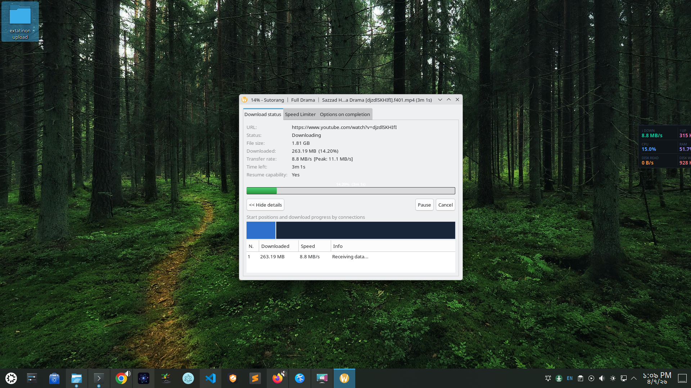
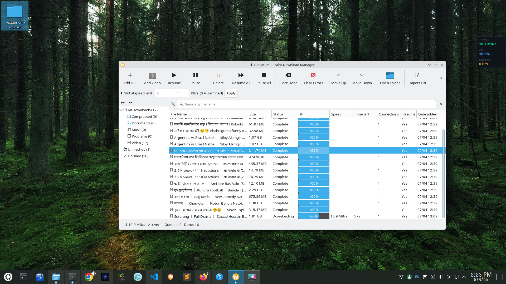

# Mint Download Manager

Mint Download Manager is an IDM-style download manager for Linux and Windows with browser integration.
It captures browser downloads, accelerates file transfers with aria2, and provides a desktop GUI with tray controls and live progress.

## Screenshots

## Highlights

- Automatic browser download capture
- Multi-connection downloads via aria2 (up to 16 connections per file)
- Smart file naming and category-based folder sorting
- Video downloader support (yt-dlp + ffmpeg) for many sites
- System tray menu (Open, Pause All, Resume All, Quit)
- Per-download progress dialog with speed, ETA, and connection details
- Desktop notifications for start, complete, pause, resume, and errors

## Requirements

Core dependencies:

- Python 3 (>= 3.10)
- PySide6 Qt bindings (python3-pyside6.qtcore, python3-pyside6.qtgui, python3-pyside6.qtwidgets, python3-pyside6.qtnetwork) — same Qt GUI as Windows
- aria2
- curl

Recommended:

- yt-dlp
- ffmpeg
- libnotify-bin
- zenity or kdialog

## Install

### Windows

Run `mintdm-1.1.4-win64-setup.exe` (per-user install, no admin needed).
Daemon + GUI start automatically, including after reboot.

### Debian, Ubuntu, Linux Mint

  sudo apt install ./dist/mintdm_1.1.4_all.deb

Or:

  sudo dpkg -i ./dist/mintdm_1.1.4_all.deb
  sudo apt-get install -f -y

Optional one-command install with extras:

  ./INSTALL.sh --with-extras

This installs MintDM plus optional tools:

- yt-dlp
- ffmpeg
- libnotify-bin
- zenity (or kdialog)

### RPM-based distros

  sudo rpm -Uvh ./dist/mintdm-1.1.4-1.noarch.rpm

## Run

- Start GUI (auto-starts daemon if needed): mintdm-gui
- Start daemon only: mintdm
- Stop daemon: mintdm-stop

Quick health check:

  curl http://127.0.0.1:9001/ping

## Browser Extension Setup

### Firefox (Recommended)

Install directly from Mozilla Add-ons:

  https://addons.mozilla.org/en-US/firefox/addon/mint-download-manager/

### Chrome, Chromium, Brave, Edge

1. **Download the extension package** from GitHub Releases:

  https://github.com/mostafijar/mintdm/releases/latest/download/chrome.extension.zip

2. **Extract the zip** to a permanent folder (for example `Documents\MintDM-extension`).
   Do not delete this folder afterwards — the browser reads the extension from it.

3. **Open the extensions page:**
   - Chrome: type `chrome://extensions` in the address bar, press Enter
   - Edge: type `edge://extensions`
   - Brave: type `brave://extensions`

4. **Turn on Developer mode** (toggle switch at the top-right corner).

5. Click **Load unpacked** (button appears at the top after step 4).

6. **Select the extracted folder** (the one containing `manifest.json`), click Select Folder.

7. **Pin the extension** so it stays visible: click the puzzle-piece icon in the
   toolbar, then the pin icon next to Mint Download Manager.

8. **Check it works:** click the MintDM icon — the popup must show
   **Daemon online**. If it shows daemon offline, start the MintDM app first,
   then reload the extension (circular-arrow icon on the extension card).

## Download Categories

Files are auto-sorted under your Downloads folder into:

- Compressed
- Documents
- Music
- Programs
- Video

## Progress Display Compatibility

Reliable on all desktops:

- Tray icon progress
- Per-download dialog progress

Best-effort (desktop/session dependent):

- Taskbar icon progress

Behavior may vary by desktop environment and Wayland/X11 session.

## Verify Downloads

Each release ships a `SHA256SUMS` file. Verify integrity with:

  cd dist
  sha256sum -c SHA256SUMS

Expected output is `OK` for every file.

Check the running daemon version at any time:

  curl http://127.0.0.1:9001/ping

Check for a newer release:

  mintdm-update-check

## Troubleshooting

- Keep yt-dlp updated for better video-site compatibility.
- If a site blocks direct fetching, enable cookie forwarding in extension settings.
- If taskbar progress is missing, use tray icon and progress dialog (fully supported).

## Links

- GitHub repository: https://github.com/mostafijar/mintdm
- Firefox add-on (AMO): https://addons.mozilla.org/en-US/firefox/addon/mint-download-manager/
- Chrome extension package: https://github.com/mostafijar/mintdm/releases/latest/download/chrome.extension.zip

## Uninstall

Debian/Ubuntu/Mint:

  sudo apt remove mintdm

## License

MIT License.
